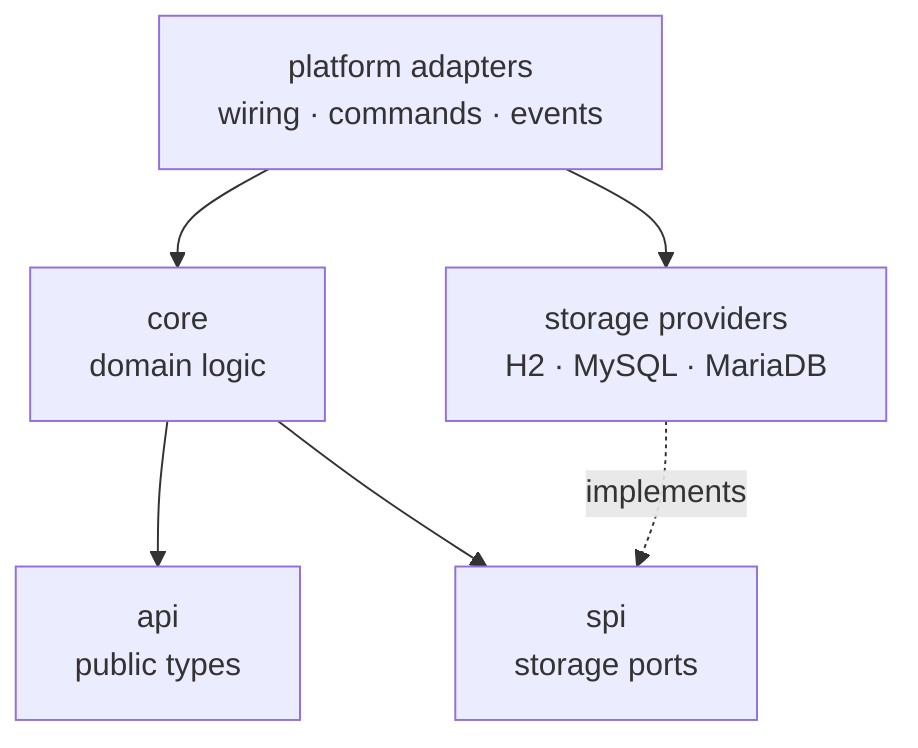

  <a href="https://mantiel.dev"><b>Portfolio</b></a> ·
  <a href="https://mantiel.dev/CV_Antony_Molina.pdf"><b>CV (ES)</b></a> ·
  <a href="https://www.linkedin.com/in/mantiel"><b>LinkedIn</b></a> ·
  <a href="mailto:contacto@mantiel.dev"><b>Email</b></a> ·
  <a href="https://wakatime.com/@eea51f52-bae0-4d12-8015-bbbf189ef07c"><b>WakaTime</b></a>

I've been building software with Java since 2021: client projects, my own products, and [Bytephoria](https://github.com/Bytephoria), the open-source organization I founded. Most of that work lives on the server side, where I focus on modular architecture, asynchronous persistence and keeping blocking I/O off latency-critical threads.

I'm now bringing that foundation to enterprise backend development with Spring Boot, and I'm looking for my first role as a **junior Java backend developer**.

  

## Focus

- **Architecture**: hexagonal, multi-module systems where the domain depends only on its own contracts.
- **Concurrency**: CompletableFuture pipelines on virtual threads and thread-safe caches that keep slow I/O from stalling the main thread.
- **Persistence**: SQL behind swappable providers, connection pooling, batched writes and versioned binary formats.
- **APIs**: fluent, type-safe Java libraries for other developers, and REST APIs with Spring as my current focus.

## Projects

### ByteClans

Java 21 · Gradle multi-module · HikariCP · H2, MySQL, MariaDB · Caffeine · GitHub Actions

Open-source community system for multiplayer game servers (clans, roles, alliances and statistics), shipped through 23 releases.

- **Hexagonal architecture** across 15 Gradle modules: the core depends only on its API and SPI contracts, while storage providers and platform adapters plug in at the edges.
- **Swappable SQL storage** with embedded H2, MySQL or MariaDB on HikariCP connection pools, using batched writes.
- **Async persistence**: database work runs on a virtual-thread executor through CompletableFuture pipelines, keeping I/O off the server's main thread.
- **Extensible and automated**: third-party add-ons load at runtime, and CI tags, writes the changelog and publishes a release on every version bump.

[View repository](https://github.com/Bytephoria/byte-clans)

### Task Management API

Java 25 · Spring Boot 4 · Spring Security · Spring Data JPA · PostgreSQL · Docker

My hands-on Spring Boot project, built while learning enterprise backend development: a REST API for projects, tasks and comments.

- **Token security**: stateless JWT authentication with rotating refresh tokens. Each refresh revokes the previous token, and tokens are stored only as SHA-256 hashes.
- **Request protection**: per-IP rate limiting (Bucket4j and Caffeine), Bean Validation and a consistent error format from a global exception handler.
- **Querying**: task filtering by project, status, priority and assignee with JPA Specifications, plus pagination and sorting.
- **Quality and delivery**: integration tests against real PostgreSQL (Testcontainers and MockMvc), OpenAPI docs, a multi-stage Docker build and CI on GitHub Actions.

[View repository](https://github.com/mantiel/task-management-api)

### More projects

- **[ByteSessionRestore](https://github.com/Bytephoria/byte-session-restore)**: session snapshot and recovery with a versioned binary format, pluggable compression (Zstandard) and fully asynchronous persistence.
- **[Evion](https://github.com/Bytephoria/evion)**: event bus library with a fluent API, sync and async dispatch, priorities, filters, cooldowns, scheduling and batched handlers.
- **[Expanse](https://github.com/Bytephoria/expanse)**: type-safe placeholder engine that resolves text in a single pass, without regex or reflection.
- **[EscribeloYA](https://escribeloya.app)**: notebook app for students (Windows, beta) that I designed and built alone with Rust, Tauri and React. Handwriting and typing share the page, PDFs export as vectors at true scale, and everything stays local.

## Experience

**Founder & Developer** · [Bytephoria](https://github.com/Bytephoria) 
2025 – present

- Founded an open-source organization with 17 MIT-licensed Java repositories, from applications to reusable libraries.
- Designed ByteClans and ByteSessionRestore around hexagonal architecture with swappable SQL persistence.
- Moved database I/O off the main thread and reduced resource usage in the storage layer.
- Use a pull-request workflow with Conventional Commits, semantic versioning and automated releases.

**Freelance Java Developer** 
2021 – present

- Built and maintained Java software for clients and my own projects, from requirements to delivery.
- Managed production systems used by more than 100 users.
- Built server-side software for multi-server game networks behind a proxy, with SQL persistence and a strict 50 ms tick budget.

## Toolbox

**Hands-on**: Java 21+, concurrency (CompletableFuture, executors, virtual threads), JDBC, SQL (MySQL, MariaDB, H2), HikariCP, Caffeine, Gradle, Maven, Git, GitHub Actions, Docker
**Learning now**: Spring Boot, Spring Security, JWT, Spring Data JPA, Hibernate, PostgreSQL, JUnit 5, Testcontainers
**Also used**: TypeScript, React, Rust, Tauri, Kotlin, Python, MongoDB, Redis

## How I work

- **Contracts first.** Storage, compression and platforms sit behind interfaces, so they can change without touching the core.
- **Slow work stays off hot paths.** I/O runs asynchronously, and caches sit in front of the database.
- **Delivery is automated.** CI builds on push, and releases are tagged and changelogged from the version number.
- **AI is a tool, not the author.** It helps me explore options and draft code. The design decisions, the review and every line I ship are mine.

Lima, Peru · <a href="mailto:contacto@mantiel.dev">contacto@mantiel.dev</a> · <a href="https://mantiel.dev">mantiel.dev</a>

